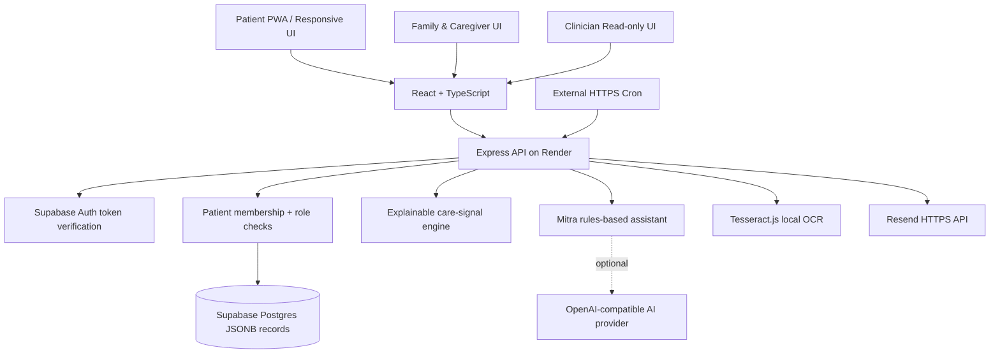

# Architecture — NalamLink AI 3.0

## Hosting and data modes

- **Render** runs the single Node web service and serves the Vite build and `/api` routes from the same origin.
- **Demo mode** uses synthetic patient data in a local JSON file. This is useful for a no-credential walkthrough but is not durable on Render Free because its filesystem is ephemeral.
- **Supabase mode** stores patient profiles in `nl_patients` and child records in `nl_records`. Supabase Auth issues user access tokens; the API validates each token and checks active membership before patient-scoped operations.
- The Supabase secret/service-role key is server-only. Browser code receives only the public anon/publishable key. RLS denies direct browser table access.

## Record model

`nl_patients` stores the patient profile JSON. `nl_records` stores one row per patient, collection and record ID. Collections include members, medications, doses, appointments, tasks, events, notifications, invitations, checkins, handoffs and shifts. The composite primary key provides deterministic idempotency for event records.

## Consistency boundaries

- Dose outcome uses a Postgres row-locking RPC. It transitions a pending/missed dose once and decrements stock in the same transaction.
- Notification delivery uses a Postgres lease RPC so concurrent dispatch workers cannot claim the same active email attempt.
- Invitation acceptance uses a Postgres transaction to verify pending state, expiry and email binding before creating membership and consuming the invitation.
- `addRecordIfAbsent` relies on the composite primary key to avoid duplicate care events.

## Care intelligence

The care-signal engine is deterministic and explainable. Each signal contains a category, severity, source reason and suggested next action. It can surface unresolved missed doses, patient requests for a check-in, overdue tasks, unacknowledged handoffs, low medication stock and appointments within 24 hours. These are coordination signals, not clinical risk scores or diagnoses.

## AI boundaries

Mitra first builds a compact summary from authorized workspace records. Without provider credentials, a deterministic summary is returned. With an OpenAI-compatible endpoint configured, the backend sends only the selected summary and user question. Patient notes are treated as untrusted content. The model is instructed not to diagnose, prescribe, alter doses or claim a dose was taken.

## External services

- Supabase: authentication and durable relational storage.
- Render: web hosting.
- Resend: optional HTTPS email delivery.
- Any OpenAI-compatible AI API: optional language generation.
- Tesseract.js: OCR processing in the Node service.
- External cron provider: optional scheduled dispatch.

No Google Cloud project or Google Cloud credits are required for this architecture.
